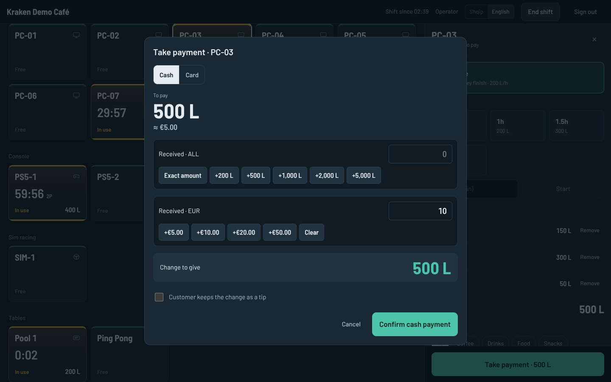
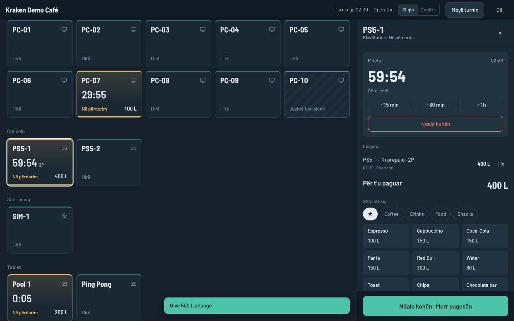

<div align="center">

# 🦑 Kraken Hub

### One screen to run the whole floor.

**Free, operator-first management software for gaming cafés and entertainment venues** —
PCs, consoles, sim rigs, pool, ping pong and table games, all on one timer model, one tab
model, one screen. Built for the person working the counter, not just the owner.

English · Shqip · offline-safe · no duplicate orders · append-only money

</div>


---

## Why another café system?

Running a café on ggLeap and iCafe, the same things hurt every shift: slow clients, duplicate
orders from a double tap, no per-PC tabs, no shift or tips view, a UI that needs training, a
locked gaming-only desktop, and remote access that never works when you need it.

Kraken Hub is the answer to those specific pains:

- **Reliable over fancy.** Offline-safe, crash-safe, no duplicate orders, every action confirms it worked. Money lives in an append-only ledger — nothing is ever edited or deleted, only reversed by a new signed entry.
- **Learnable in 10 minutes.** If a new hire needs training, the screen is wrong. Common actions are 1–3 taps.
- **Everything the venue rents, in one place.** A PC, a PS5 priced by player count, a sim rig, a pool table — all are just *stations* with a timer and a tab. A new type is configuration, not new code.
- **A real Windows desktop for customers,** safely limited and wiped after each session — not a locked gaming-only shell. Not everyone comes to game.
- **One-tap fixes from the counter.** Move a frozen session to another PC, restart a machine, recover every session after a power cut — without losing time or money.
- **Free while we build.** No paywall until mainstream release; reliability and core operator features are never paywalled.

## What it does today

Kraken Hub already runs a café end to end. This is built and working, not planned:

**Floor & sessions**
- Live floor map with a card per station (free · busy · ending · reserved · problem), time and tab total at a glance
- Prepaid, open-time (postpaid) and per-game pricing; player-count rates for consoles, changeable mid-session
- **Group sessions** — link several stations onto one shared tab for a party
- **Move a live session** to another station in one tap when a PC freezes (time and rate carry over, no re-charge)
- **Floor map** — lay the room out as it really is: drag each station to its place, give it a shape that looks like the real thing (PC desk, round pool table, console sofa, long table), and draw labelled areas (VIP room, the bar). Operators recognise a station by where it is and what it looks like, not by a number — and switch back to the list view any time

**Money — append-only and operator-proof**
- A tab per station: time, drinks, snacks; move, merge, and **split bills** equally or by amount
- Checkout in cash, card or mixed, **lek + euro** with live conversion, quick-cash buttons and change in large type
- Tips kept separate from revenue; printable itemised **receipts**
- Shifts with opening float, blind cash count, drawer reconciliation and an end-of-shift report
- Every change is **signed in an audit log** nobody can edit; every order carries a client-generated ID so a double tap can never duplicate it
- Manager-approved refunds, voids and corrections, posted as reversing lines

**Running the business**
- **Members & loyalty** — points earned and redeemed, a member directory
- **Bookings** — the manager schedules; stations show as reserved; the operator checks customers in; no-show handling
- **Inventory** — stock drops with each sale, low-stock alerts, restock orders received and confirmed
- **Business reports** — revenue, cash vs card, tips, best-sellers, by day
- **Guided first-run setup** — go from empty to a working floor in a few taps

**Customer PCs**
- One self-contained Windows client: finds the counter, pairs securely, locks and unlocks with the session
- Lock screen with **Continue as guest** (operator-approved), an in-session widget to order and ask for help
- Remote restart / shut down / log off / message from the counter
- **Setup mode** so whoever installs a PC is never locked out before it's configured

**Reliability built in**
- SQLite in WAL mode survives power loss with no lost transaction
- A crashed PC auto-pauses so nobody pays for dead time; **power-cut recovery** pauses and offers to resume every session after an outage
- **Automatic rolling backups** of the whole database, plus one-tap download
- **PC health monitoring** — disk, memory, CPU, temperature and crash reports from each PC, with floor alerts

**Multi-branch**
- Each branch runs fully on its own; a small central hub rolls up **combined reporting across all branches** (offline-safe, nothing customer-level leaves a branch)

**Bilingual from day one** — every screen in English and Albanian, more languages to follow.

<p align="center">
  
  
</p>

## How it fits together

Each branch runs its own host, so the café never depends on the internet. One web codebase
serves every screen; a small native agent handles deep Windows control.

| Part | What it is | Tech |
| --- | --- | --- |
| **Hub Host** | One per branch: sessions, pricing, tabs, ledger, shifts, backups | Node.js + TypeScript, built-in SQLite (WAL) |
| **Hub Desk / Manager** | Operator floor + manager settings and reports, in the browser | React + TypeScript, served by the host |
| **Hub Client** | Agent on each customer PC: pairing, lock, widget, health, remote | C# / .NET + WebView2 |
| **Central Hub** | Optional: cross-branch reporting dashboard | Node.js + TypeScript, built-in SQLite |

No native build tools, no database server to install — the database is built into Node, so the
host installs with nothing to compile.

## Getting started

See **[docs/RUNNING.md](docs/RUNNING.md)** for the full walkthrough. In short, on the host PC:

```powershell
git clone https://github.com/UncleKraken/kraken-hub.git
cd kraken-hub
npm install
npm run build
npm run seed   # optional: a demo café to explore
npm start
```

Open `http://localhost:7300` on the host, or `http://<host-ip>:7300` from a counter PC or tablet.
Demo logins: `admin` / `admin123` (manager), `operator` / `1234` (operator). Customer PCs run the
[Windows client](client/README.md) — or open `http://<host-ip>:7300/client` in any browser to try
the customer screens without a real PC.

## Documentation

- **[Product spec](docs/SPEC.md)** — the full design: roles, stations, money, client, reliability, roadmap
- **[Running Kraken Hub](docs/RUNNING.md)** — install, demo data, where data lives, updating
- **[Windows client](client/README.md)** — installing and setting up a customer PC
- **[Central hub](hub/README.md)** — multi-branch reporting rollup

## Status & roadmap

A solid first version for the pilot is the goal, and reliability beats feature count.

| Phase | When | Status |
| --- | --- | --- |
| 1 · Host & Hub Desk | Nov 2026 | ✅ Floor, sessions, tabs, POS, checkout, currencies, shifts, tips, ledger, roles |
| 2 · Hub Client | Dec 2026 | ✅ Pairing, lock screen, guest approval, widget, remote power, setup mode *(lockdown presets & session wipe pending)* |
| 3 · Pilot & release | Jan 2027 | 🔜 Live café pilot · bookings ✅ · inventory ✅ · health ✅ · backups ✅ · reports ✅ · floor map ✅ · multi-branch rollup ✅ |
| After release | 2027 | Shared members & catalog across branches, remote desktop, router Boost, storage modes, bundles & VIP pricing, more languages |

**Pilot:** the owner's own café branch, hardware going in now.

## License

All rights reserved. This repository is public for transparency during development; no license is
granted to use, copy or redistribute the code.
