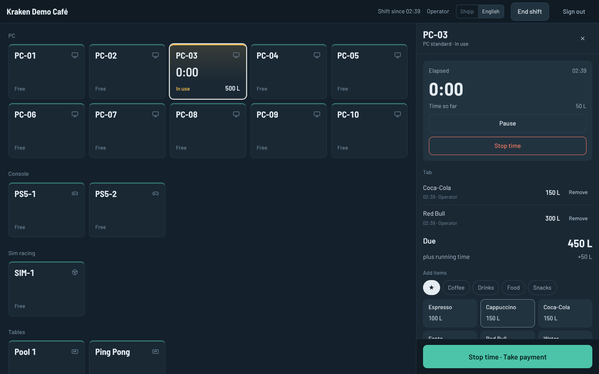

# Kraken Hub

Operator-first management software for gaming cafés and entertainment venues: PCs, consoles, sim rigs, pool, ping pong and table games, all run from one screen.

> **Status:** Phase 1 done, Phase 2 under way. The host server and Hub Desk run end to end: shifts, sessions on every station type, tabs, checkout in lek and euro, tips, the end-of-shift report, and manager settings for stations, prices, products, staff and currencies, with shift history and a signed activity log. Customer PCs pair with the counter, lock and unlock with sessions, and send guest, order and help requests through the [Windows client](client/README.md). Bookings: the manager schedules them, stations show as reserved, and the operator checks customers in. Inventory: stock drops with sales, low items are flagged, and restock orders are received and confirmed. Pilot at a live café, targeted release end of January 2027. See [docs/RUNNING.md](docs/RUNNING.md) to try it.

## Why

Existing café software (ggLeap, iCafe and others) is built for the manager and makes the operator's shift harder: slow clients, duplicate orders, no per-PC tabs, no shift or tips view, locked gaming-only desktops and broken remote access. Kraken Hub is built around the person working the floor.

- **Reliable over fancy:** offline-safe, no duplicate orders, every action confirms it worked.
- **Learnable in 10 minutes.**
- **Everything the venue rents** in one system, one timer model, one tab model.
- **Real Windows desktop** for customers, safely locked down and wiped after each session.
- **One-tap remote fixes** for the common problems (ping, audio, peripherals, frozen PCs).

## How it fits together

| Part | What it is | Tech |
| --- | --- | --- |
| **Hub Host** | Runs on one PC per branch; sessions, pricing, tabs, ledger, shifts | Node.js + TypeScript, SQLite (WAL), Windows service |
| **Hub Desk** | Operator panel: floor map, POS, checkout, shifts | Web app served by the host |
| **Hub Manager** | Manager dashboard: prices, products, bookings, reports | Web app served by the host |
| **Hub Client** | Agent on each customer PC: lockdown, session wipe, health, auto-fixes | C# / .NET Windows service + WebView2 |
| **Cloud relay** | Multi-branch dashboard, IT remote access, backups (later) | Small cloud service, outbound-only |

## Documentation

- [Product spec](docs/SPEC.md): the full design (roles, stations, money, client, reliability, roadmap)
- [Running Kraken Hub](docs/RUNNING.md): install, demo data, where data lives, updating

## Roadmap

| Phase | When | Scope |
| --- | --- | --- |
| 1 · Host and Hub Desk | Nov 2026 | Floor map, sessions, tabs, POS, checkout, currencies, shifts, tips, ledger, roles |
| 2 · Hub Client | Dec 2026 | Installer and pairing, lock screen, guest approval, lockdown, session wipe, widget, remote power |
| 3 · Pilot and release | Jan 2027 | Live café pilot, bookings, inventory, health alerts, Albanian and English UI |

## License

All rights reserved. This repository is public for transparency during development; no license is granted to use, copy or redistribute the code.
